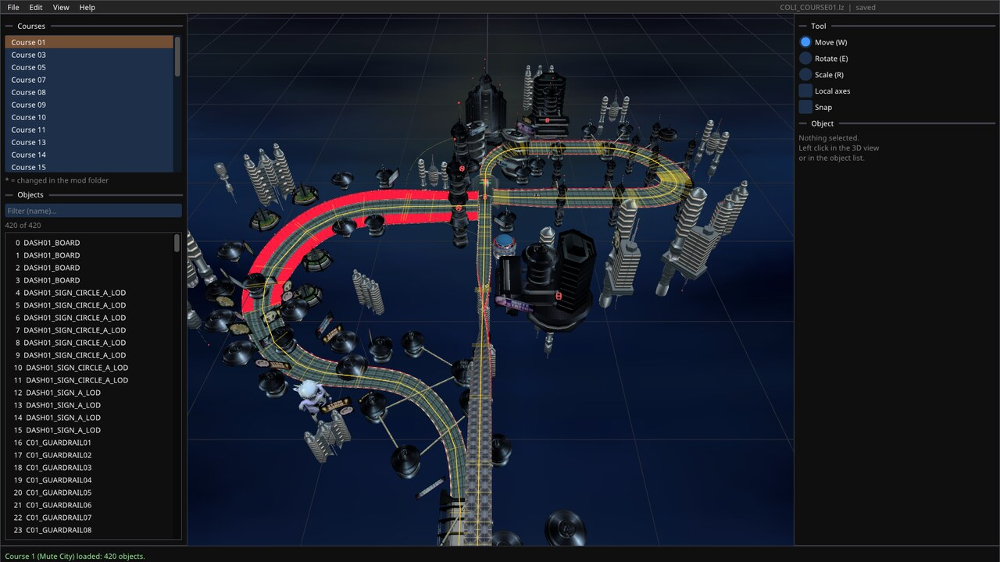
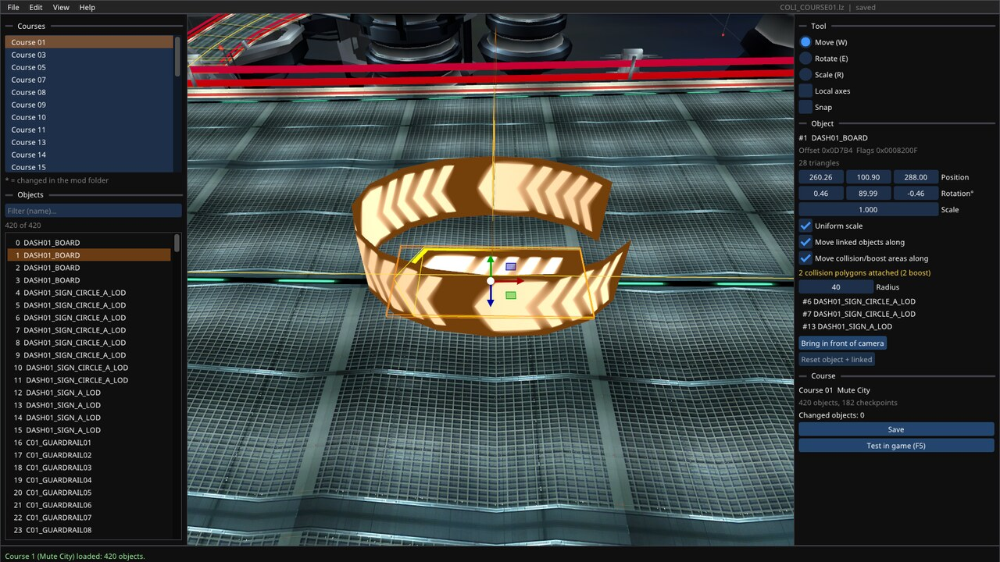
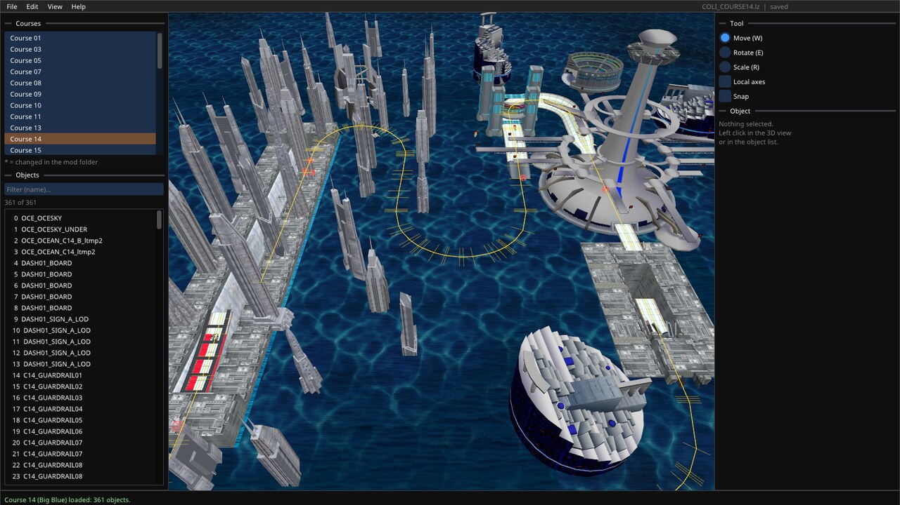
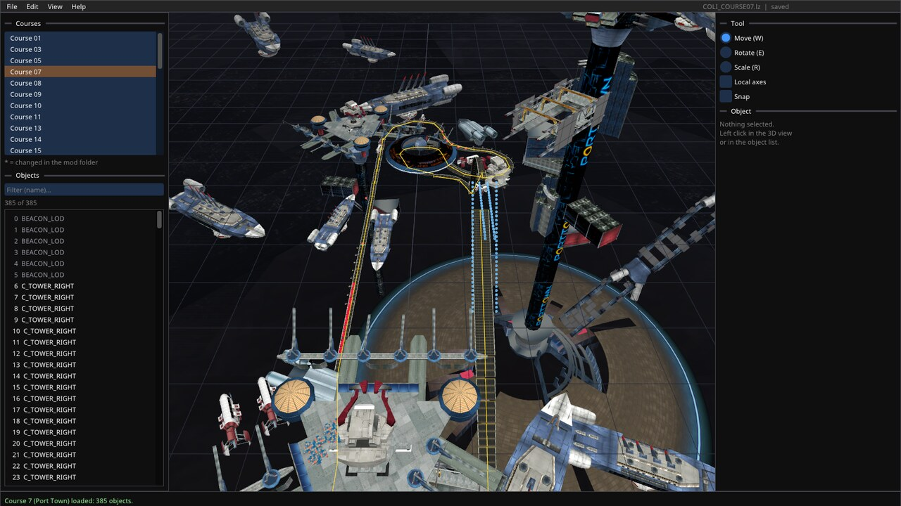

# F-Zero GX Course Editor

<picture>
  <source media="(prefers-color-scheme: dark)" srcset="docs/eu-ai-icons/ai-generated-white.svg">
  
</picture>

https://github.com/theSilviteElders/F-ZERO-GX-Course-Editor.git

A standalone course editor for F-Zero GX (USA, `GFZE01`) with a test button for
[F-ZERO GLINUX](https://github.com/Mabec-games/F-ZERO-GLINUX). First
milestone: view courses and move, rotate and scale placed objects (dash plates,
signs, buildings, road models …) together with their boost areas.



No game data is included: you need your own F-Zero GX image (USA, RVZ or ISO).
Put it in `rom/` (inside the repository, git-ignored), in a `rom/` folder next
to the repository, or pick it in the editor under *Settings*.

## Screenshots

| | |
|---|---|
|  |  |
| Editing a dash plate: plate, arrow marker and ring are linked; the yellow outline is the boost area that moves along. | Big Blue – Drift Highway |
|  | |
| Port Town | |

The screenshots show the game's own models and textures, loaded from your
disc at runtime.

## Building

Requires CMake ≥ 3.20, a C++20 compiler, SDL3, libepoxy and glm (Arch/CachyOS:
`sdl3 libepoxy glm`). CMake downloads Dear ImGui 1.91.9 and ImGuizmo itself.

```bash
git clone https://github.com/theSilviteElders/F-ZERO-GX-Course-Editor.git
cd F-ZERO-GX-Course-Editor
cmake -S . -B build -DCMAKE_BUILD_TYPE=RelWithDebInfo
cmake --build build -j
./build/fzgx-editor
```

A step-by-step test guide is in [TESTING.md](TESTING.md).

## Workspace (`work/`, git-ignored)

| Path | Contents |
|---|---|
| `work/disc/` | original disc, extracted once from the RVZ (never modified) |
| `work/mod/GFZE01/` | test copy (btrfs reflink, takes almost no space) with the edited files |
| `work/glinux-runtime/` | unpacked GLINUX AppImage + direct-start savestate (`quickstart-practice.sav`) |
| `work/test-userdir/` | separate copy of the GLINUX user folder for tests (protects your saves) |
| `work/editor.ini` | settings (ROM, AppImage, GLINUX user folder, launcher) |
| `work/cups.ini` | custom cups (name, courses, icon colour) |
| `work/launch.log` | output of the last game launch |

The disc is extracted with `dolphin-tool` (Dolphin Flatpak), either in the
editor under *File → Settings* or with
`scripts/extract-disc.sh <rom.rvz> work/disc`.

## Usage

- **Camera:** hold the right mouse button + WASD/QE to fly (Shift faster,
  Ctrl slower, mouse wheel changes the speed). Without the right mouse button:
  mouse wheel moves forward/back, middle mouse button pans.
- **Selection:** left click in the 3D view or in the object list
  (double click focuses), `F` focuses, `Esc` clears the selection.
- **Gizmo:** `W` move, `E` rotate, `R` scale; optional snapping. The gizmo sits
  at the model centre; scaling keeps the object (and its linked objects) in place.
  Values can also be typed into the inspector on the right.
- **Structures:** the *Structures* tab lists placeable copies of what the
  course already contains, grouped into boost & special zones (e.g. dash
  plate + marker + rings + boost polygons), object groups, single objects and
  track pieces. Click an entry, then click in the 3D view (Shift+click for
  several, Esc cancels). `Ctrl+D` duplicates the selection, `Del` deletes a
  placed object.
- **Track spline:** `T` (or *Edit → Edit track spline*) shows the points of
  the track's position curves. Click one and move it with the gizmo. The
  checkpoints, track distances, track length, distance-based surface areas
  and the checkpoint grid are recomputed on save. Road models and static
  collision (walls) do not move along.
- **Magnetism:** when moving an object with the gizmo or placing a
  structure, the closest border vertex of the moved model snaps onto a
  border vertex of another model within the range (border = vertices on the
  four horizontal sides of the model's bounding box, e.g. the ends of road
  pieces, so they join edge to edge); track
  points snap onto other track points. A pink line shows the snapped pair.
  Switch it off with the *Magnetism* checkbox (saved in `work/editor.ini`
  together with the range) or hold **Alt** to move freely for a moment.
- **Ctrl+Z / Ctrl+Y:** undo / redo.
- **Ctrl+S:** saves the compressed course into `work/mod/GFZE01`.
- **F5:** saves and starts the game from the mod folder directly in a race on
  the open course (see *Direct start*).
- **Linked objects** (e.g. dash plate + arrow marker + ring) are edited
  together: same name prefix, within the radius.
- **Cups:** the course list shows each course's track name and the cups it
  belongs to. *File → Cups…* lists the game's cups and lets you create up to
  two **custom cups** (name, gem colour of the icon, up to five
  courses). *Save cups and write mod folder* (and every F5) writes a patched
  `sys/main.dol` and the icons into the mod folder. In the game the cup
  selection gets an arrow behind the AX Cup that leads to a second page with
  the custom cups, in every mode with a cup selection (Grand Prix, Time
  Attack, Practice, VS Battle). Start the game normally (direct start off) to
  pick them.
  Details: [docs/cup-format.md](docs/cup-format.md).
- **Textures:** *View → Textures* or *File → Settings → Load textures*
  (on by default, saved in `work/editor.ini`). Without textures the models are
  drawn in their material colour, which is lighter and faster.

## Direct start

`scripts/run-test.sh` uses the GLINUX runner's automation directory
(`--automation-dir`, command files for controller input, memory and
savestates):

1. Once per GLINUX version: navigate the menus automatically (Practice →
   Ruby Cup → Twist Road → Blue Falcon → settings dialog) and save a savestate
   there, right before the course is loaded.
2. On every test: load that savestate, write the course number to
   **`0x803FFB71`** (u8, the number of the `COLI_COURSExx.lz` the game loads
   next; found by comparing RAM for the five Ruby Cup courses and cross-checked
   with course 14 → Big Blue) and press OK. The course is then loaded from the
   mod folder. The address is computed relative to the main module
   (`[0x800030C8] + 0x245471`), because the custom-cup patch moves it.

NTSC-U (`GFZE01`) only. There is no direct start with Dolphin as launcher.

## What is known (formats)

- `.lz`: 8-byte header (LE: packed size without header, unpacked size) +
  LZSS with a 4 KiB ring starting at `0xFEE`. The editor's compressor is
  verified lossless and produces files about the same size as the originals.
- `COLI_COURSExx`: header `0x48`/`0x54` = count/pointer of the placed objects
  (`0x40` bytes each: position, rotation as s16 with 65536 = 360°, scale,
  pointer to a 3×4 matrix). `M = Rz·Ry·Rx·S` holds for all ~18,000 objects.
  The editor writes both (TRS + matrix). Scene objects (model references,
  `0x10` bytes: LOD count, LOD list → name) are listed at `0x64`/`0x68`.
  Track checkpoints (`0x08`) provide the centre line and width, the static
  collision (`0x1C`) triangles/quads in 14 surface grids.
- Static collision: triangle `0x58` / quad `0x70` bytes:
  `d = −n·v0`, `n = normalize((v1−v0)×(v2−v0))`, vertices, then per edge
  `e_k = (n × (v[k+1]−v[k])) · |(v[k+1]−v[k]) × (v[k−1]−v[k])|`. Verified
  against every polygon of all 37 courses. Polygons are found through one XZ
  grid per surface type (u16 index lists terminated by `0xFFFF`).
  **Type 3 = dash plate (boost).** The boost zone is a separate collision
  polygon in world coordinates and is not attached to the dash plate object.
  The editor moves collision polygons lying entirely under an edited object
  along with it, recomputes plane and edges, and registers them in newly
  covered grid cells by appending new index lists to the file. Outside the
  grid a polygon probably has no effect (the editor warns).
- `.gma`: GCMF models with GX display lists. Course models are in
  `stage/stNN.gma`, shared objects in `bg/bg_*.gma`. Texture slots (`0x20`
  bytes after the `0x40` GCMF header): `+0x03` wrap flags, `+0x04` index into
  the `.tpl` of the same name; every mesh uses its first texture layer.
- `.tpl`: `u32 count`, then `0x10` per texture (format, offset, width, height,
  mip levels, `0x1234`); offset 0 = empty slot. GX formats I4, I8, IA4, IA8,
  RGB565, RGB5A3, RGBA8 and CMPR are decoded
  (`./build/fzgx-cli tplsheet <file.tpl.lz> <out.ppm>` writes a contact sheet).

`./build/fzgx-cli selftest work` checks all 37 courses: parsing, unchanged
round trip (byte-exact), LZ round trip, transform formula, collision formulas
and model coverage. More commands: `dump <work> <course>`,
`move <work> <course> <index> dx dy dz`,
`dashscale <work> <course> <factor> <out.lz>` (test: scale all boost polygons
and write to a separate file), `unlz`, `lz`.

## Limitations / next steps

- Road models are visuals only: driving surface, physics and AI come from the
  track spline. The spline can be edited (see `docs/track-format.md`), but
  road models and walls stay where they are, and whether the game follows
  the edited spline is not tested in the game yet.
- New objects are copies of objects in the same course (same scene object,
  flags and pointers). On save the instance table (header `0x48` count,
  `0x54` pointer) is copied to the end of the file with the new entries
  appended. Nothing else points into that table. Added collision polygons
  extend copies of the triangle/quad arrays the same way. Not tested in the
  game yet. Only objects placed in the current session can be deleted;
  original objects cannot be removed.
- Models from other courses cannot be placed (the game only loads the
  course's own model archives).
- Some models (skinned/animated, 16-bit vertices) appear as a blue box,
  models that are not found as a red box.
- Whether every object really appears in the game where it was moved
  (e.g. visibility/collision grids) has to be tested in the game.
- Textures use only the first layer and the first UV set (no multi-texture
  blending, texture scrolling or environment maps).
- Generated road models for new track pieces, snapping track pieces together.
- Custom cups: at most two, NTSC-U only. Tested in the game: menus, cup
  intro, course screens and the first race in Grand Prix, Time Attack and
  Practice. Not tested yet: a complete Grand Prix to the results screen, and
  VS Battle (needs two controllers).
  The glow of the selected custom cup icon uses the AX Cup colour.

## AI disclosure

The source code and documentation of this project were generated with AI
(Claude by Anthropic), based on the maintainer's instructions. The maintainer
chose the direction, tested the results in the game and reviews the changes.
Commits written with AI carry a `Co-Authored-By: Claude` line. The label above
is the official [EU icon for AI-generated content](docs/eu-ai-icons/README.md).

## License

MIT, see [LICENSE](LICENSE). F-Zero GX is © Nintendo / Sega / Amusement
Vision; this project contains no game data.
